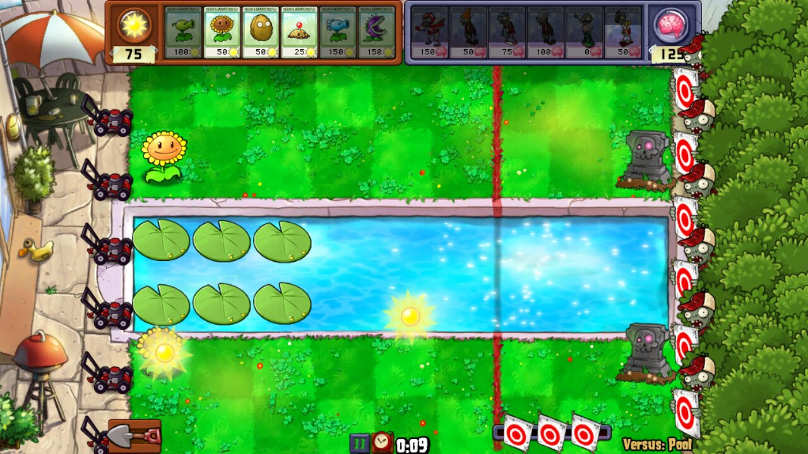
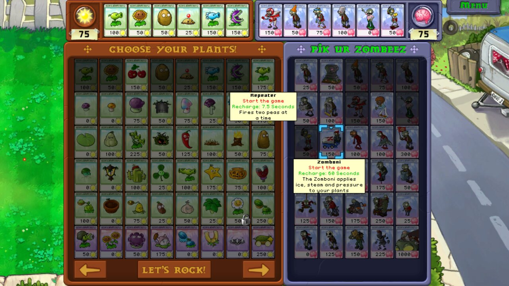

# Plants vs. Zombies: DLC Edition

**The fan-made DLC Edition v2.7.2 on Nintendo Switch, Mac, Windows, Linux and Android**

Left: a versus match on the pool. Right: the versus draft, played with a finger each on one screen.

---

## About

An unofficial port of [Plants vs. Zombies: DLC Edition](https://discord.gg/rTz2QHD9aR) v2.7.2, the fan expansion of
Plants vs. Zombies by Samen and the DLC team, to:

- **Nintendo Switch** (homebrew): controllers, touch in handheld mode, versus with a controller each.
- **Android** (arm64, Android 10+): touch first, controllers too, versus with a finger each on one screen.
- **Mac** (Apple Silicon), **Windows** (x64) and **Linux** (x86_64 for PCs and the Steam Deck, arm64 for ARM boards
  and handhelds): the PC game as it is, with the mouse and keyboard (versus is mouse against keys, as on PC), plus
  controllers. On a Steam Deck the controls play first, as on the Switch.

Everywhere: 16:9 widescreen (HenryJk's PvZWidescreen art and PvZ Touch's lawn bushes), and controller play in the
style of the Xbox 360 edition and PvZ Touch: the D-pad steps the lawn's squares, L / R pick seed packets, hold B to
dig, the game's own pictures for button prompts.

It is not an emulator. The DLC Edition's x86 exe is translated to C ahead of time (`recomp/tools/x86recomp`), and a
small Windows of its own (`recomp/runtime`: kernel32, user32, DirectDraw, Direct3D 7, DirectSound, BASS ...) runs it
natively. The Switch draws with deko3d, the others with OpenGL / OpenGL ES through SDL2.

**No game files are included.** You need your own Plants vs. Zombies (Game of the Year, 1.0.0.1051, from Steam or the
EA app, or the original) and the DLC team's download of the DLC Edition v2.7.2, which is patches for it. The port
applies the patch itself on the first launch (no DeltaPatcher needed), then unpacks the game; an exe you already
patched works too.

## Download

The [Releases](../../releases/latest) page has one zip per platform. Each has a README with how to install it and the
controls.

## Building

The build needs the game's exe, so nothing generated from it is in this repository; neither are the pictures (PopCap's
and EA's art, or made from it). Both come from your side:

1. **The game's exe.** Run any release once with your PlantsVsZombies.exe and the DLC's patch (or your DLC Edition
   exe): it unpacks `dlc_game.exe` (the exe without its Enigma Virtual Box packer) into its game folder. Copy it to
   `analysis/dlc_game.exe`.
2. **The recompiled code.** With a Python 3 that has `capstone` and `pefile`:
   `cd recomp && make gen PY=python3` (writes `recomp/gen/`, about 180 MB of C).
3. **libopenmpt 0.8.9** (the MO3 music): unpack `libopenmpt-0.8.9+release.makefile.tar.gz` from
   [lib.openmpt.org](https://lib.openmpt.org/libopenmpt/download/) into `recomp/third_party/libopenmpt`.
4. **The pictures.** The icons are in `icons/` (the Switch's is `recomp/nx/icon.jpg`, made from `icons/switch.png`).
   Unzip the release's `PvZ_DLC_Edition_Art` zip at the top of the repository (it gives
   `port_art/` and `gamedata/wide/`), then `cd recomp && python3 tools/embed_art.py ../port_art host/port_art.c`.
5. **Build** (in `recomp/`):

| Platform | Command | Needs |
| --- | --- | --- |
| Switch | `make TARGET=a64 -j8` → `build/a64/pvzdlc.nro` | devkitPro (devkitA64, libnx, deko3d, uam), `DEVKITPRO` set |
| Mac | `make TARGET=play -j8`, then `../tools/package_mac.sh "Beta 2.5.3"` | Homebrew GCC 15 and SDL2 |
| Windows | `make TARGET=win64 -j8`, then `../tools/package_windows.sh "Beta 2.5.3"` | llvm-mingw (UCRT) and SDL2 2.32.10's mingw files in `TOOLCHAIN` |
| Android | `../tools/build_android.sh "Beta 2.5.3" 28` | the NDK r27d dmg and SDL2 2.32.10's source in `TOOLCHAIN`, the Android SDK's build-tools 34, a JDK |
| Linux | `../tools/build_linux.sh x86_64` (or `arm64`), then `../tools/package_linux.sh "Beta 2.5.3" x86_64` | Docker (the image in `tools/linux/`, made on the first run) and SDL2 2.32.10's source in `TOOLCHAIN` |

`TOOLCHAIN` is the folder with the downloaded toolchains (`make TOOLCHAIN=...`, or the environment for the scripts).
The Android script makes its own signing key the first time (`android/release.keystore`): keep it, and never publish it.
The game code takes a while to compile the first time (a few minutes to tens of minutes, by platform).

## Credits

- **Plants vs. Zombies** by PopCap Games / Electronic Arts. Buy the game to play this.
- **Plants vs. Zombies: DLC Edition** by Samen and the DLC team
  ([Seeds community Discord](https://discord.gg/rTz2QHD9aR)).
- **Widescreen backgrounds**: HenryJk's PvZWidescreen (GPL-3.0). **Lawn bushes**: PvZ Touch / TV (PopCap / EA).
- **Port**: aks796.

The libraries and code this builds on are listed in [THIRD_PARTY_NOTICES.md](THIRD_PARTY_NOTICES.md).

## License

The port's own code is under the [GPL-3.0](LICENSE). This is an unofficial fan project: it is not affiliated with or
endorsed by PopCap Games, Electronic Arts, the DLC team, Nintendo, Apple, Google or Microsoft.
